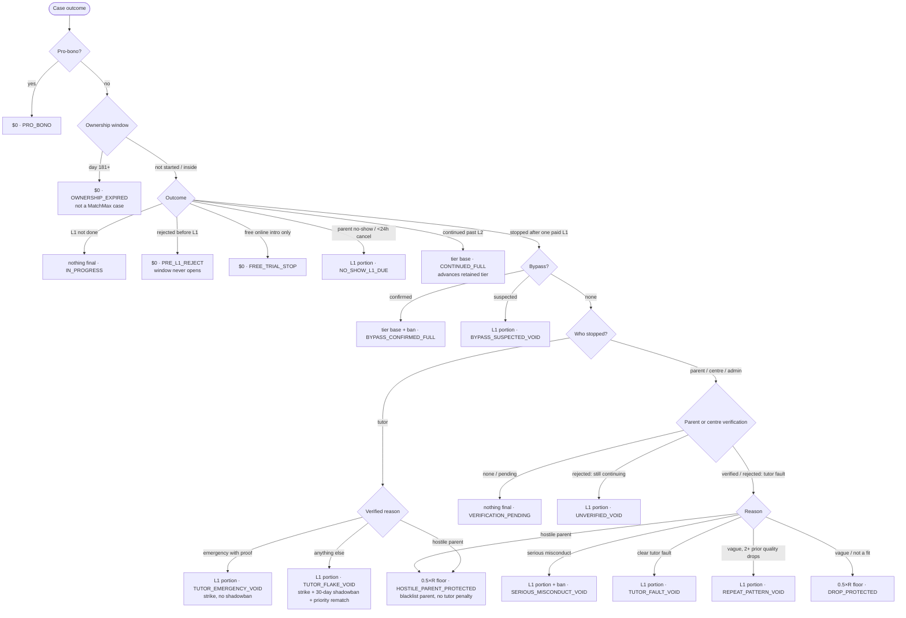

# Fee and Drop state machine (#536)

Single source of truth for the #537 Fee · Drop · Trust cluster. The code is
`src/features/cases/fee-drop.ts` (`resolveCaseFee`), fed by
`src/features/cases/ownership-window.ts` (#508). Tests:
`tests/cases/fee-drop.test.ts`, `tests/cases/ownership-window.test.ts`.

Change a rule on #536 and in `fee-drop.ts` first, then the child issues
(#520, #525, #508, #528, #529).

`R` = the case's locked `hourly_rate_hkd`, the same rate basis the #385
match-fee panel invoices 1.5× on (CEO 2026-10-30). Amounts scale by student
count and round once to whole HKD.

## Diagram

## Table

| Event | MatchMax fee | Tutor | Parent / centre | Rule id |
| --- | --- | --- | --- | --- |
| Pre-L1 reject | $0, no Ownership window | none | none | `PRE_L1_REJECT` |
| Continues to L2+ (first Regular) | tier base, 1.5×R for tier 1 / primary | none | none | `CONTINUED_FULL` |
| Stop after one paid lesson, verified, vague reason | min(base, 0.5×R) | keeps the rest | none | `DROP_PROTECTED` |
| Clear tutor fault | L1 portion (1.0×R) | no form | none | `TUTOR_FAULT_VOID` |
| Hostile / abusive parent (verified) | min(base, 0.5×R) | no penalty | blacklisted | `HOSTILE_PARENT_PROTECTED` |
| Tutor L1 quit | L1 portion + priority rematch, no parent refund | strike + 30-day shadowban | none | `TUTOR_FLAKE_VOID` |
| Tutor emergency with proof | L1 portion | strike, no shadowban | priority rematch | `TUTOR_EMERGENCY_VOID` |
| Same-client ladder | 1.5 → 1.0 → 0.5 → $0; protection floor 0.5×R | none | none | tier input |
| Day 181+ Ownership | $0, not a case | tutor's relationship | none | `OWNERSHIP_EXPIRED` |
| Centre secondary in window | Retained-Only ladder | none | none | tier input |
| Parent no-show / <24h cancel before L1 | L1 portion, not Drop-Protection | none | none | `NO_SHOW_L1_DUE` |
| Suspected bypass | L1 portion, protection void | flagged | none | `BYPASS_SUSPECTED_VOID` |
| Confirmed bypass | tier base, ban (human action) | banned | none | `BYPASS_CONFIRMED_FULL` |

Notes:

- L1 portion = min(tier base, 1.0×R) under `100_50`, min(tier base, 0.75×R) under the opt-in `75_75` A/B.
- A tutor-funded first-lesson discount scales the L1 portion and the protection to the amount actually paid. Regular lessons stay on full R.
- Only parent or centre confirmation can reduce the fee. Admin-reviewed evidence is accepted only on the tutor-initiated hostile-parent and emergency paths (`dropRecordError`).
- Consequences (blacklist, strike, shadowban) apply once per rule change, so re-saving a decision never double-counts. Bans stay a human action.
- No parent refund in any row. Rematch is the parent remedy.

## Trust and safety (#529 V1)

Rules, not an LLM (`src/features/trust/safety-screen.ts`). Every hit is a
`case_risk_flags` row; humans resolve all of them at `/admin/trust-safety`.

| Signal | Where | Effect |
| --- | --- | --- |
| Industrial / hotel venue phrases (EN + 繁中; study subjects excluded) | request intake | `HIGH_RISK_LOCATION`; hold (`compliance_hold`) for adult learners |
| Adult learner + specific tutor gender + time ≥ 21:30 | request intake | hold + `LATE_NIGHT_ADULT` |
| Overpayment / cheque / wire / crypto language | request intake | hold + `SCAM_OVERPAYMENT` |
| "Pay directly" / skip MatchMax language | request intake | flag `BYPASS_COLLUSION_RISK` |
| "Tried N agencies" or 3+ early drops in 30 days | request intake | flag `SERIAL_HOPPER_PARENT` |
| Requester on `trust_blacklist` | request intake | hold + `BLACKLISTED_CONTACT` (not rejected, no tip-off) |
| Lesson 1 within 12 h, tutor unconfirmed | queue load | flag `TUTOR_GHOST_RISK` + ops ping |

Tutor-facing: parent contact masked until the intro fee is settled or the
tutor has 3+ verified hours; lesson location hidden only while a blocking
flag is open or the case has ended. New tutors hold at most 2 open first
lessons (`app_settings.trust_new_tutor_first_lesson_cap`).

Not in V1 (needs vendors): +852 SMS OTP, WhatsApp Business webhook
classifier, T-16h tutor nudge. Rate floors stay Later until tuned on data.

## L1 retention fit data (#528 Phase A)

Code: `src/features/cases/fit-tags.ts`. No fee rule changes.

- A verified stop after Lesson 1 needs one fit tag (`drop_fit_reason`, `fitReasonError`).
  Tutor-side reason classes preselect it (`tutor_flake` / `tutor_emergency` → `TUTOR_QUIT`).
- Tutor quit: the desk panel offers the priority-rematch WhatsApp script (24–48h, no extra
  cost, no refund) next to the `TUTOR_FLAKE_VOID` / `TUTOR_EMERGENCY_VOID` preview.
- Optional soft tags (teaching style, materials, vibe, homework) live on `tutors` (tutor sets
  them in settings) and on `tutoring_cases.pref_*` (desk sets them from the parent). `fitHint`
  never counts an unset tag against a tutor. A materials mismatch with both sides set is a
  hard block for suggestions.
- Backend-only signals: `case_fit_signals` (match → Lesson 1 booked, Lesson 1 reschedules).
